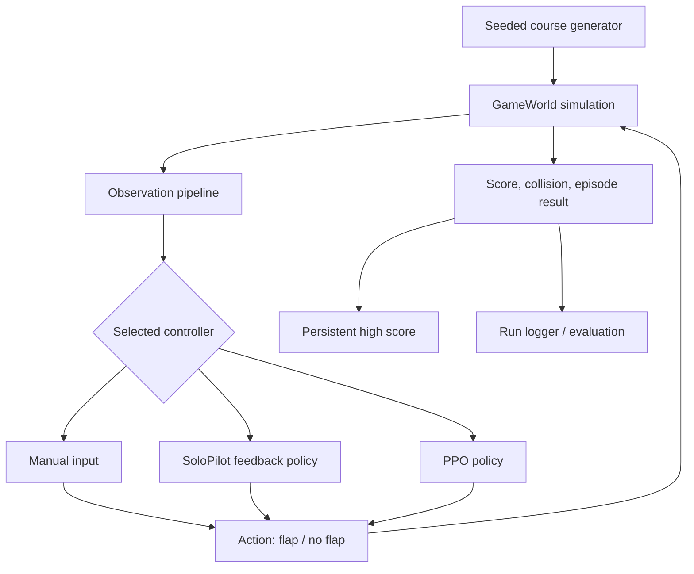
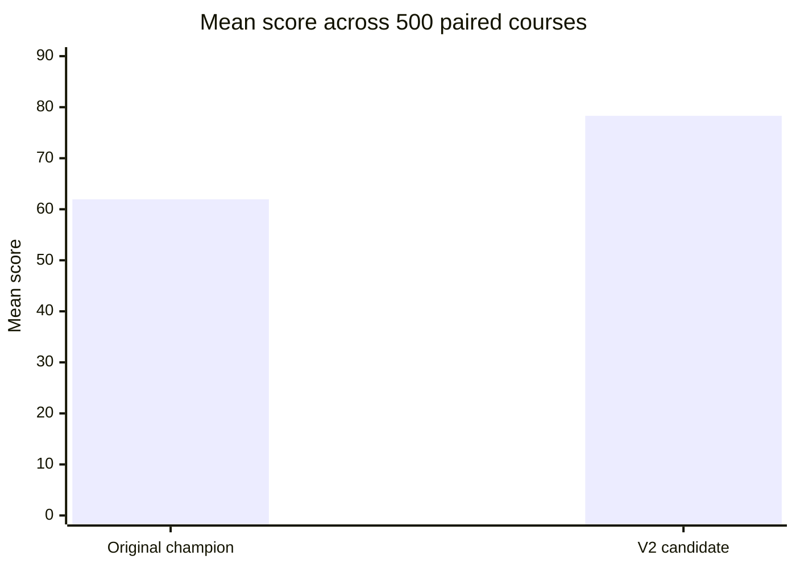
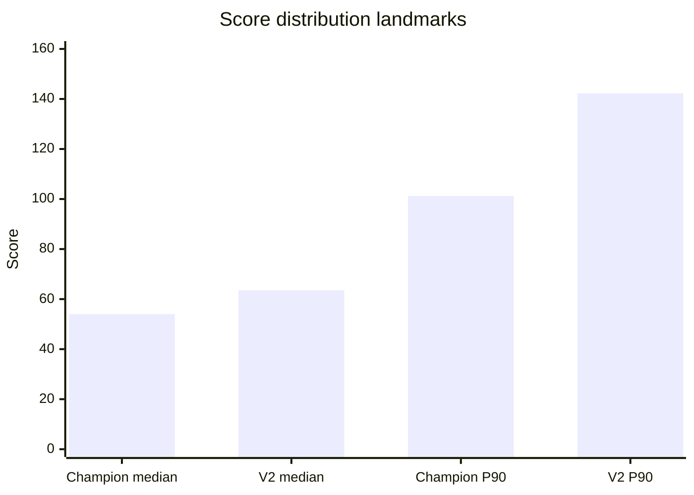
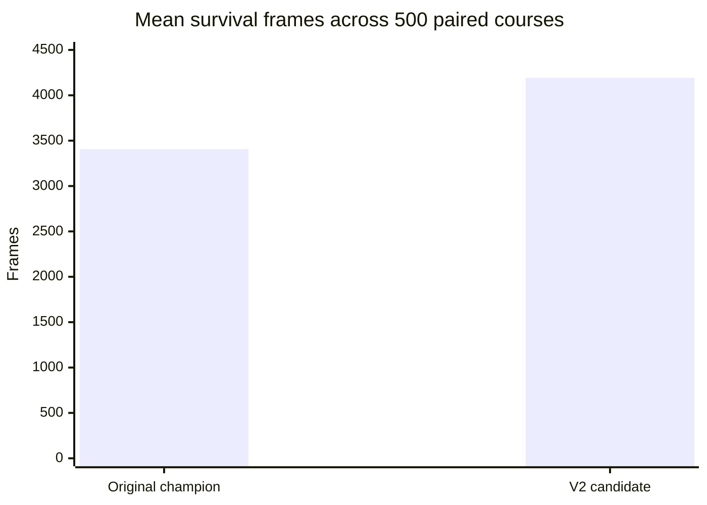
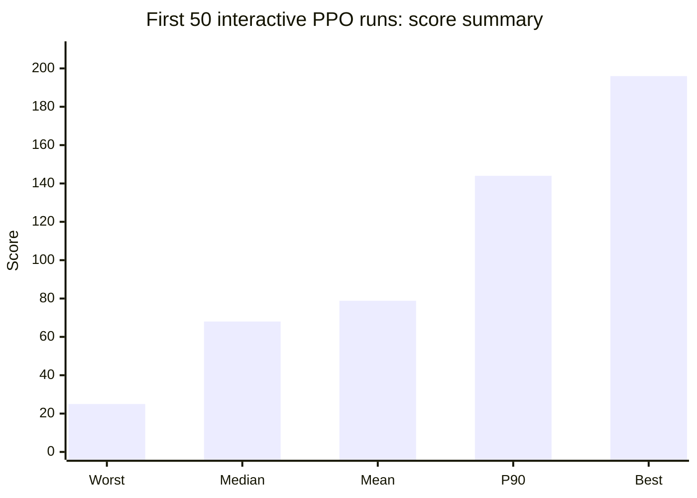

# 🐦PROXIMAL FLAP: SOLO

<p align="center">
  <strong>One bird. One course. No two runs quite alike.</strong><br>
  <em>Train it. Test it. Find out whether it can actually fly.</em><br>
  A deterministic Flappy Bird-style simulation with autonomous control, PPO reinforcement learning, and reproducible evaluation.
</p>

<p align="center">
  
  
  
  
</p>

PROXIMAL FLAP: SOLO is a single-agent game and reinforcement-learning testbed. It combines a continuously generated obstacle course, deterministic simulation, multiple control strategies, and an evaluation workflow for comparing autonomous policies.

The project began with a simple objective: make one bird survive a progressively difficult course. It has since grown into a small experimental environment for training, evaluating, and comparing reinforcement-learning controllers. The bird still has a habit of hitting pipes. Now we can measure how intelligently it does it.

---

## 📚 Contents

- [Project overview](#project-overview)
- [Highlights](#highlights)
- [System architecture](#system-architecture)
- [Control modes](#control-modes)
- [Reinforcement learning](#reinforcement-learning)
- [Evaluation and results](#evaluation-and-results)
- [Benchmark visualizations](#benchmark-visualizations)
- [Run logging](#run-logging)
- [Installation](#installation)
- [Gameplay](#gameplay)
- [Training and evaluation commands](#training-and-evaluation-commands)
- [Testing](#testing)
- [Project structure](#project-structure)
- [Experimental notes and limitations](#experimental-notes-and-limitations)

## 🐦 Project overview

The simulation presents one bird navigating a continuous stream of procedurally generated pipes. A collision ends the current episode; after a short reset interval, the next run begins automatically. Human input remains available, so the same environment can be used for manual play and autonomous-agent experiments.

The environment includes:

- A compact **400 × 600** simulation and presentation surface.
- Score-dependent difficulty, with progressively narrower gaps and faster pipes.
- Bounded procedural variation in gap placement.
- Deterministic, seedable course generation for repeatable experiments.
- A transparent rule-based controller (SoloPilot).
- A PPO-trained reinforcement-learning controller.
- Persistent high scores and automated per-run logging.

## ✨ Highlights

| Area | Implementation |
|---|---|
| Simulation | Renderer-independent game world and deterministic stepping |
| Course generation | Seeded procedural pipe stream with bounded gap movement |
| Difficulty | Score-dependent gap width, pipe speed, and spacing |
| Controllers | Manual input, SoloPilot feedback policy, PPO policy |
| Reinforcement learning | Proximal Policy Optimization (PPO) |
| Evaluation | Fixed-seed and paired-course policy comparisons |
| Telemetry | Timestamped run log with controller mode and final score |
| Rendering | Pygame, with a crimson / charcoal / cream visual identity |

### 📐 Difficulty progression

The course is designed to become more demanding as a run progresses:

- Gap widths begin around **110–140 px** and tighten toward approximately **106–118 px**.
- Pipe speed increases from approximately **3.45** to **4.6 pixels per frame** over the first 36 cleared pipes.
- Gap centres follow a weighted random walk rather than arbitrary jumps.
- The maximum vertical displacement between consecutive gap centres is bounded.
- The maximum difficulty profile is reached after 36 cleared pipes and remains active.

These values describe the current course configuration, not a universal difficulty guarantee across every possible seed.

## 🧩 System architecture

At a high level, the project separates simulation, rendering, control, and learning:



The simulation is kept separate from the Pygame renderer so that course behavior and controller performance can be tested without opening a game window. Seeded evaluation makes it possible to compare policies on identical generated courses rather than relying on a handful of memorable runs.

## 🎮 Control modes

| Mode | Description |
|---|---|
| **Manual** | The player controls each flap. |
| **SoloPilot** | A deterministic feedback controller uses the bird's state and the next safe gap to choose when to flap. |
| **PPO AI** | A trained policy selects actions from the V2 observation pipeline. |

SoloPilot is a rule-based controller, not a neural network. PPO is the learned controller. Keeping both available makes it possible to compare a transparent hand-designed policy with a policy learned through reinforcement learning.

## 🧠 Reinforcement learning

The project uses **Proximal Policy Optimization (PPO)** through Stable-Baselines3. The V2 experiment introduces a separate observation and reward pipeline rather than silently changing the original champion's input contract.

### 🔍 V2 observation pipeline

V2 uses a **20-feature observation vector** designed to provide more information about the bird's immediate state and upcoming obstacles. The feature design includes normalized state, time-to-contact and ballistic estimates, gap boundaries, and information about upcoming pipes.

The V2 implementation is kept in separate modules:

- `ai/observations_v2.py`
- `ai/environment_v2.py`
- `ai/rewards_v2.py`
- `ai/train_v2.py`
- `ai/evaluate_v2.py`

This separation allows the V2 experiment to evolve without changing the original champion's 12-feature observation contract.

### 💾 Checkpoint policy

The original champion and V2 checkpoint are separate artifacts. The V2 checkpoint is used for current PPO gameplay, while the original champion is retained as a rollback and comparison reference. Training or promoting a candidate should never overwrite the only copy of a known-good model.

## 📊 Evaluation and results

Two different evaluation records are reported below. They answer related but distinct questions and should not be merged into one statistic.

### 🧪 1. Controlled paired benchmark: 500 generated courses

The original champion and V2 candidate were evaluated on the **same 500 seeds**, from `50000` through `50499`. This paired design reduces the effect of course difficulty when comparing the two policies.

| Metric | Original champion | V2 candidate |
|---|---:|---:|
| Episodes | 500 | 500 |
| Mean score | 61.956 | **78.312** |
| Median score | 54.0 | **63.5** |
| 90th percentile | 101.2 | **142.3** |
| Best score | 259 | **436** |
| Worst score | 17 | 19 |
| Mean survival frames | 3,406.56 | **4,192.83** |

**Paired outcome:** V2 scored higher in 277 courses, tied in 60, and scored lower in 163.

- Mean-score difference: **+16.356 points**.
- Relative mean-score increase: approximately **26.4%**.
- V2 won or tied in **67.4%** of paired courses.

The worst observed score was 19 for V2 versus 17 for the original champion. This benchmark supports promoting V2 as the current gameplay policy on this evaluation set. It does not establish that V2 will outperform the original policy on every possible course or under every configuration.

### 🎮 2. Live gameplay validation: first 50 recorded runs

A separate run log captured consecutive PPO gameplay sessions in the interactive game. The first 50 recorded entries produced the following summary:

| Metric | First 50 recorded runs |
|---|---:|
| Recorded runs | 50 |
| Mean score | **78.84** |
| Median score | **68** |
| 90th percentile | **144** |
| Best score | **196** |
| Worst score | **25** |

This sample is a practical gameplay sanity check. It is not a paired seeded benchmark: the interactive runs do not use the same controlled seed protocol as the 500-course experiment. Its mean is therefore reported separately and should not be treated as a direct replacement for the controlled benchmark.

The run log also continued beyond the initial 50-run target. The first-50 summary above is intentionally frozen to that initial sample so that later runs do not silently change the reported validation result.

## 📈 Benchmark visualizations

### Mean score: controlled paired evaluation



### Median and 90th-percentile score



### Mean survival duration



### Live gameplay validation: first 50 runs



> **Reading the charts:** the first three charts summarize the controlled, same-seed 500-course comparison. The final chart summarizes the separate first-50 interactive run sample. Different evaluation protocols are shown separately on purpose.

## 📝 Run logging

Interactive PPO sessions are recorded automatically in:

```text
proximal_flap_runs.log
```

The log is saved in the project root, alongside `main.py`. Each completed run records:

- Timestamp
- Run number
- Controller mode
- Final score

This makes it possible to collect a useful sample without manually recording every attempt. The log is a local experiment artifact; it does not need to be committed to the repository.

## ⚙️ Installation

Python **3.10 or newer** is recommended.

```bash
# Create a virtual environment
python -m venv .venv

# Windows PowerShell
.venv\Scripts\Activate.ps1

# macOS / Linux
# source .venv/bin/activate

# Install core dependencies
python -m pip install -r requirements.txt

# Launch the game
python main.py
```

If Windows blocks script activation, invoke the environment's interpreter directly:

```powershell
.venv\Scripts\python.exe -m pip install -r requirements.txt
.venv\Scripts\python.exe main.py
```

### Optional AI dependencies

Install the reinforcement-learning dependencies separately:

```powershell
python -m pip install -r requirements-ai.txt
```

The game can still be used for manual or SoloPilot gameplay without the optional AI dependencies.

## 🕹️ Gameplay

| Key / input | Action |
|---|---|
| `1` | Manual mode |
| `2` | SoloPilot deterministic controller |
| `3` or `M` | PPO AI |
| `A` | Toggle Manual / SoloPilot |
| `SPACE`, `UP`, or left click | Flap in Manual mode |
| `P` | Pause / resume |
| `R` | Start a fresh run immediately |
| `H` | Open / close the controls panel |
| `ESC` | Close the panel, or quit the game |

The current gameplay entry point loads the V2 checkpoint when the model and optional AI dependencies are available. If the model cannot be loaded, the game falls back to SoloPilot. The best score is persisted in `data/best_score.json`.

## 🧪 Training and evaluation commands

### 🧯 Smoke training

Use a short run to verify the training environment and dependencies before committing to a longer experiment:

```powershell
python -m ai.train_v2 --timesteps 50000 --n-envs 2
```

### 🏋️ V2 training

```powershell
python -m ai.train_v2
```

### 📊 V2 evaluation

```powershell
python -m ai.evaluate_v2 --model ai/checkpoints/experiments/ppo_proximal_flap_v2.zip --seeds 100
```

Use the command-line help for the exact options supported by the current training and evaluation modules:

```powershell
python -m ai.train_v2 --help
python -m ai.evaluate_v2 --help
```

### 🎯 Deterministic baseline

A fixed-seed baseline can be generated with:

```bash
python -m tools.benchmark --seeds 100 --frames 30000
```

Per-seed baseline results are written to `data/deterministic-baseline.json`. Compare future controllers on the same seed set and frame limit.

## ✅ Testing

The simulation logic is renderer-independent and can be tested without opening a Pygame window:

```bash
python -m unittest discover -s tests -v
```

Run the test suite after changing simulation physics, course generation, controller integration, or reward/observation behavior.

## 🗂️ Project structure

```text
PROXIMAL-FLAP/
├── ai/
│   ├── checkpoints/
│   │   └── experiments/
│   ├── environment_v2.py
│   ├── evaluate_v2.py
│   ├── observations_v2.py
│   ├── rewards_v2.py
│   └── train_v2.py
├── assets/
│   ├── concept/
│   ├── fonts/
│   ├── sounds/
│   └── sprites/
├── data/
├── game/
│   ├── controller.py
│   ├── entities.py
│   ├── renderer.py
│   └── world.py
├── tests/
├── config.py
├── main.py
├── storage.py
├── requirements.txt
├── requirements-ai.txt
└── pyproject.toml
```

The tree is intentionally representative rather than exhaustive; helper modules and checkpoint files may vary between revisions.

## 🔬 Experimental notes and limitations

- **Benchmark scope:** the reported 500-course comparison covers one fixed seed range (`50000–50499`). Results may differ on other seed ranges.
- **Interactive sample:** the first 50 gameplay runs are not paired against the original champion and are not a substitute for controlled evaluation.
- **Stochastic performance:** a policy's score can vary substantially from course to course. Mean, median, percentiles, and paired outcomes provide more context than a single high score.
- **Checkpoint integrity:** keep the original champion checkpoint separate from experimental candidates.
- **Reproducibility:** record the model checkpoint, observation/reward version, evaluation seed range, and environment configuration whenever producing a new benchmark.

## 🚀 Current scope and future work

The current project focuses on one bird, one active controller, continuous procedural gameplay, and policy evaluation. It does not currently include population-based evolution, species tracking, or a multi-agent training dashboard.

Potential next steps include broader seed-range evaluation, confidence intervals or bootstrap analysis, ablation studies for V2 observation features, and automated benchmark report generation.

---

# 🛠️Engineered by Kenny Richardson